# GitHub Copilot Usage Lens: screenshots

Every screenshot uses the made-up sample report (choose **View a sample report** on the start page). The people, organizations and numbers are invented. No real data is shown.

Pages, in the order of the side menu:

- [Start page](#start-page)
- [Overview](#overview)
- [Usage and pool](#usage-and-pool)
- [Recommendations](#recommendations)
- [Licenses](#licenses)
- [Users](#users)
- [User details](#user-details)
- [Segments](#segments)
- [Models](#models)
- [Efficiency](#efficiency)
- [Organization](#organization)
- [Patterns](#patterns)
- [Data](#data)
- [Settings](#settings)
- [Methodology](#methodology)
- [Arabic, dark mode](#arabic-dark-mode)

## Start page

Drop one or more usage report files, or open the sample report. It also says how to download the report from GitHub. The file is read in the browser tab and is never uploaded.

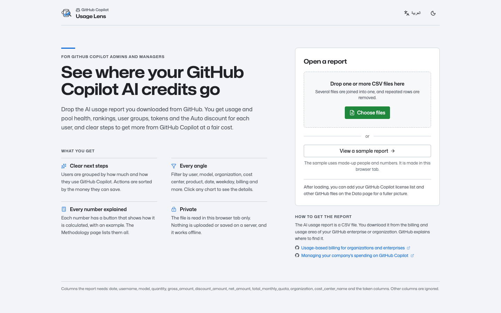

## Overview

The short answer for managers. It shows a headline verdict, the key figures with trends (usage, billed, included credits used, savings potential, Auto share, active users) and the top actions to take next.

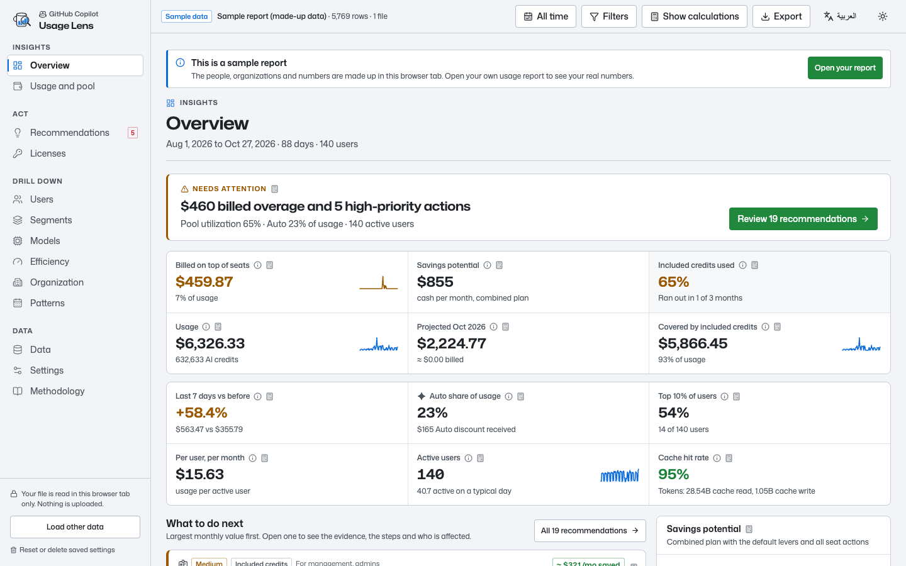

## Usage and pool

How the included credits are spent. It shows usage over time, how fast each month's pool runs out, a projected month end, budget tracking and a plain explanation of how billing works.

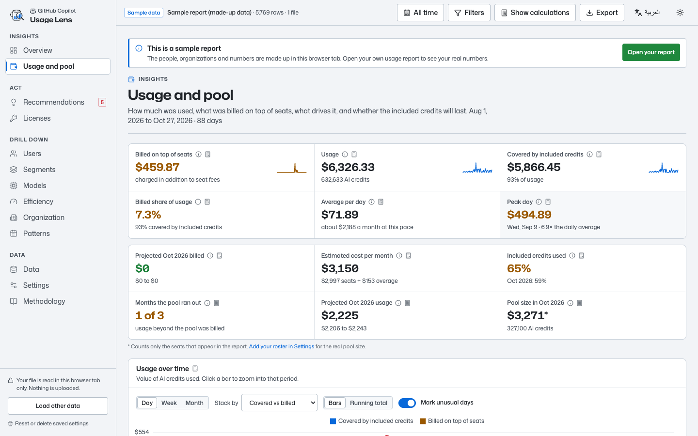

## Recommendations

What to change, ordered by impact. Each recommendation has the evidence, the steps, who it affects, an estimated saving and official links. The what-if simulator works out the combined saving, because savings from separate recommendations overlap.

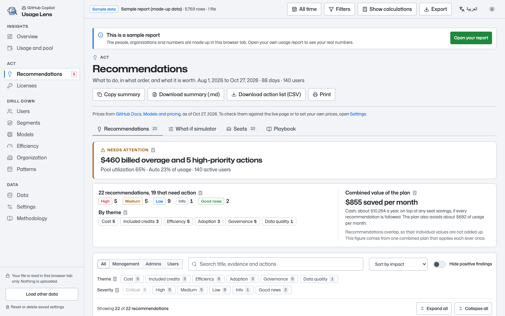

## Licenses

Seats from your GitHub Copilot license list: who uses them, who does not, last activity, and seats you can free up. With the sample report the license list is not used, so real names never mix with invented data.

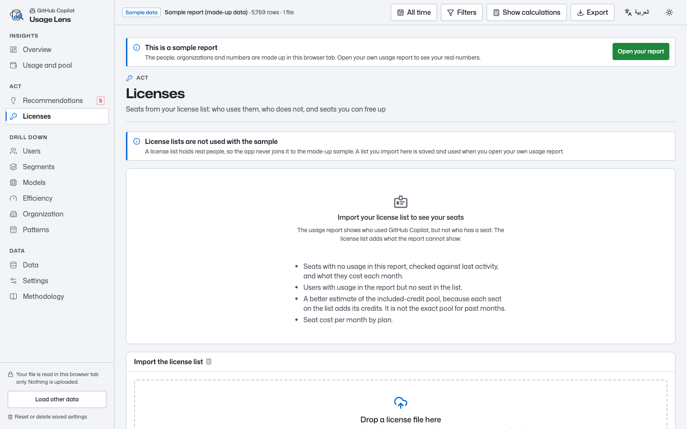

## Users

Who uses what. It ranks users by any metric and shows how concentrated usage is. It lists users who need attention (runaway, fading or new) and has a full table with tokens, including cache read and cache write.

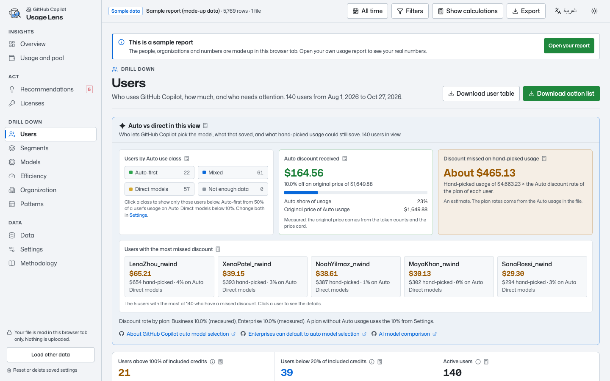

## User details

Click a user to open their details: groups and traits, usage, billed amount, included credits used, daily usage, models and Auto use, and personal tips.

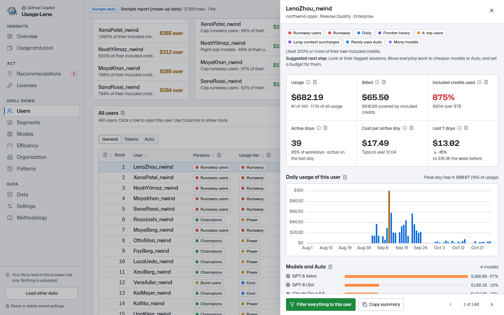

## Segments

Users in groups, compared side by side: persona, usage tier, engagement, usage profile, Pareto class, Auto use and traits. Each group shows its share of users and usage and the savings it could bring.

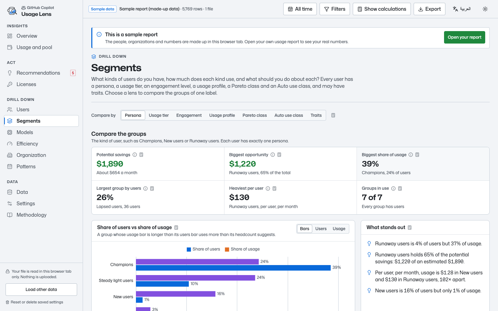

## Models

Which models cost the most. It shows a model ranking, the split by model group and vendor, Auto compared with hand-picked models, the Auto discount, right-sizing ideas and the price card in use.

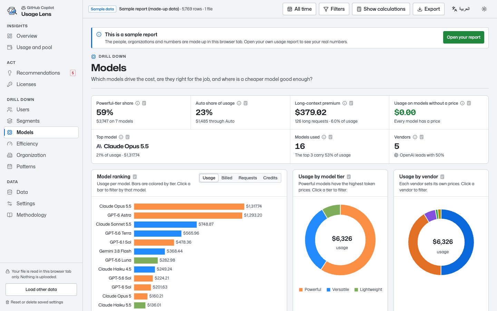

## Efficiency

How well GitHub Copilot is used. It has a scorecard from best to worst, savings levers and their combined effect, tokens and cache reuse, and cost per active day.

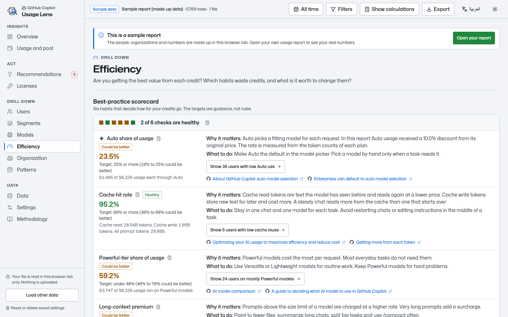

## Organization

Which parts of the business create the usage and the bill. View by organization, cost center, repository, application or product, as a ranking and a treemap. Use it for showback and chargeback.

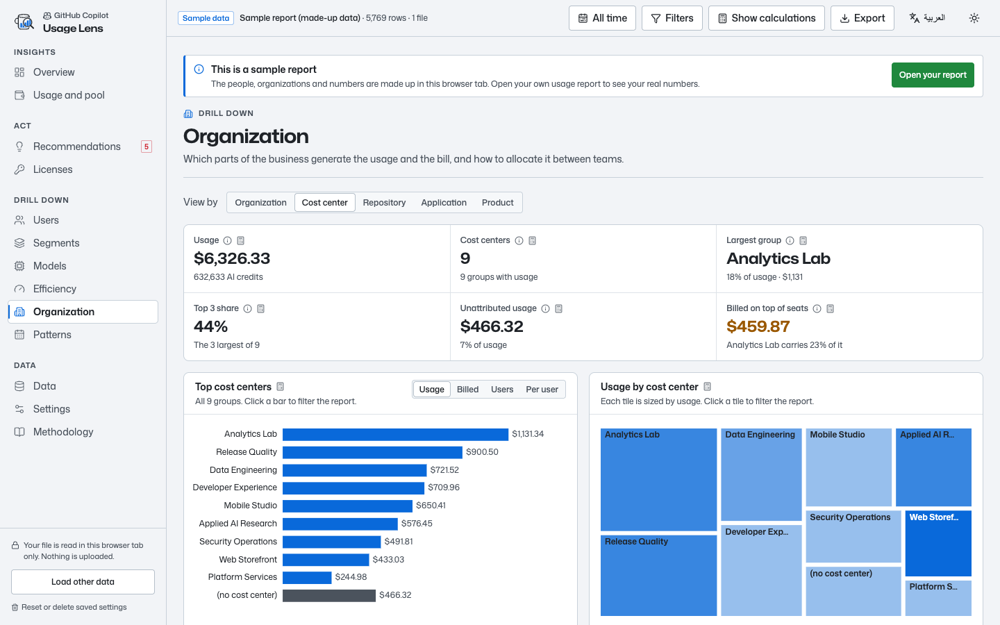

## Patterns

When GitHub Copilot is used. It shows a daily timeline with unusual days marked, the busiest weekday, the weekend share, a calendar view and the adoption curve.

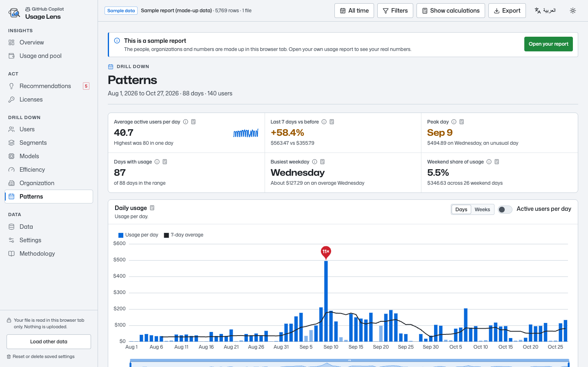

## Data

What was loaded and how clean it is: rows read and kept, duplicates, users, models, organizations and cost centers. You can add a license list here and download the filtered rows as CSV.

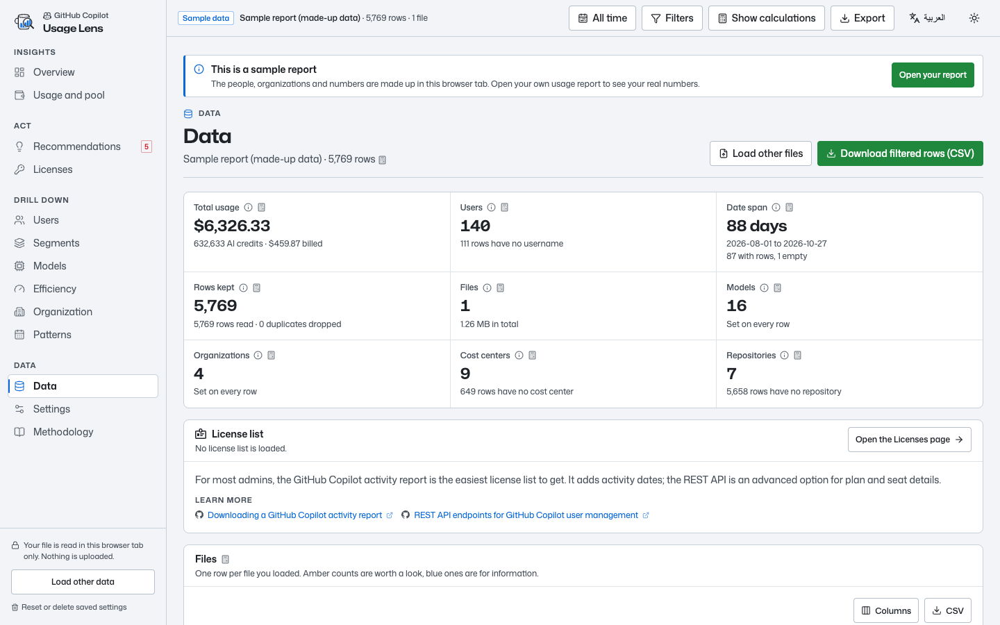

## Settings

Your budget, license list, the thresholds behind the user groups, model price overrides, appearance (theme, colors and Arabic digits) and a glossary. Settings stay in this browser.

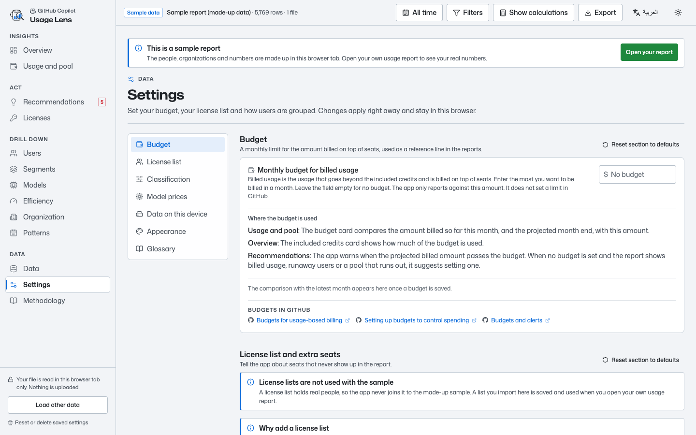

## Methodology

Every calculation in one searchable list: what it means, the formula, the columns it uses and its limits. The same text opens from the info button next to each number.

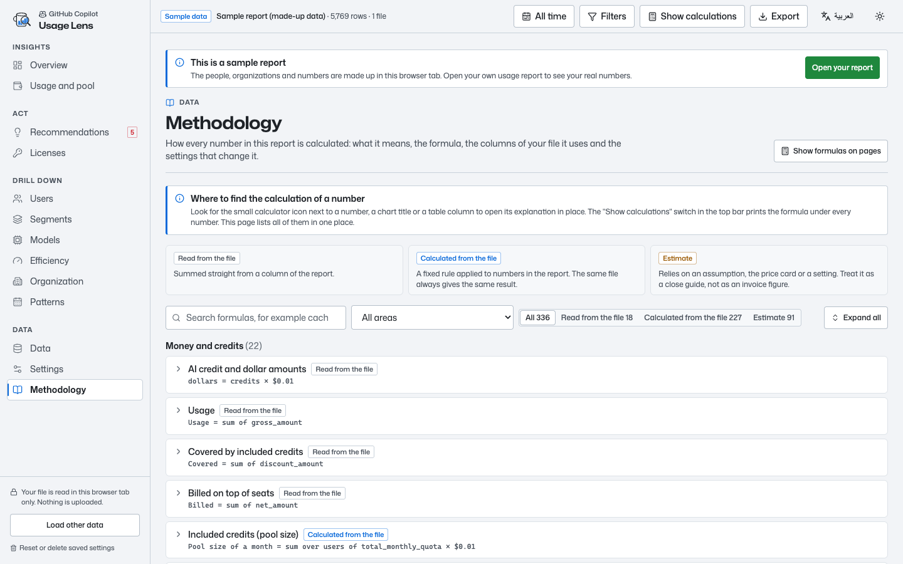

## Arabic, dark mode

The whole app is also in Arabic, right to left, in light and dark mode. Arabic shows Arabic-Indic digits by default.

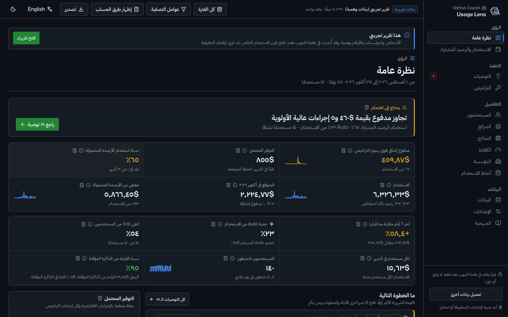
